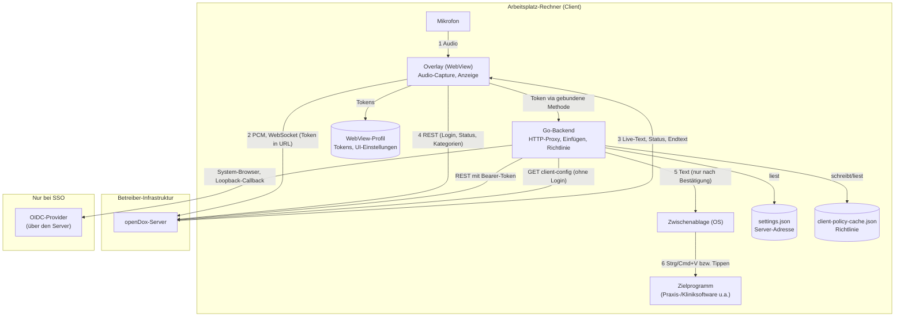

# Data Mapping — openDox Client

Technische Bestandsaufnahme, welche (personenbezogenen/medizinischen) Daten durch den
openDox Client fließen, wo sie herkommen, wohin sie gehen, wo sie auf dem Arbeitsplatz-Rechner
liegen und wie lange. Gedacht als Ausgangspunkt für ein Verzeichnis von
Verarbeitungstätigkeiten (Art. 30 DSGVO), eine Datenschutz-Folgenabschätzung (Art. 35 DSGVO)
oder ein Gespräch mit Datenschutzbeauftragten/IT — ersetzt keine Rechtsberatung und keine
Einzelfallprüfung der jeweiligen Betriebsumgebung.

**Wichtig für Betreiber:** Dieses Dokument beschreibt den Datenfluss des **Clients**. Was der
Server mit den Daten macht (Transkription, LLM, Speicherung, Aufbewahrung, Verschlüsselung,
Auftragsverarbeiter) steht in der `docs/data-mapping.md` des openDox-Server-Repositorys — beide
Dokumente gehören zusammen. Der Client selbst speichert **keine Aufnahmen und keine Texte**
dauerhaft; er ist ein Durchlauferhitzer zwischen Mikrofon, Server und Zielprogramm.

## Systemübersicht

Die Nummerierung folgt dem zeitlichen Ablauf einer Aufnahme.

## Datenkategorien

| Kategorie | Beispiele | Wo im Client |
|---|---|---|
| Gesundheitsdaten (besondere Kategorie, Art. 9 DSGVO) | Gesprochener Inhalt, Live-Text, fertiges Transkript/Zusammenfassung | nur im Arbeitsspeicher der WebView; Endtext zusätzlich kurz in der Zwischenablage und im Zielprogramm |
| Zugangsdaten | Passwort (nur während der Eingabe), Access- und Refresh-Token | Passwort im Komponenten-State bis zum Absenden; Tokens im WebView-Profil (`localStorage`) |
| Nutzerbezogene UI-Daten | gewählte Kategorie und gewähltes Mikrofon (je Nutzer-ID im Schlüsselnamen), offene Sitzungs-ID, Live-Ansicht | WebView-Profil (`localStorage`) |
| Betriebsdaten des Rechners | Name/Titel des Vordergrundprogramms (Windows) | nur Anzeige im Overlay und Allow-Listen-Prüfung, nie gespeichert oder geloggt |
| Konfiguration | Server-Adresse, Client-Richtlinie | `settings.json`, `client-policy-cache.json` (keine personenbezogenen Daten) |
| Geräteinformationen | USB-IDs und Tastenzustände von Diktiermikros | nur im Arbeitsspeicher |

## Verarbeitungsschritte im Detail

| # | Schritt | Daten | Ziel/Empfänger | Code-Referenz |
|---|---|---|---|---|
| 1 | Aufnahme | Mikrofon-Audio (Float32-PCM) | WebView-Arbeitsspeicher; Capture läuft nur während einer Aufnahme (Tracks werden beim Stopp beendet) | `Recorder.tsx` (`getUserMedia`, `AudioWorklet`) |
| 2 | Audio-Übertragung | PCM-Frames | konfigurierter openDox-Server, WebSocket (`ws://`/`wss://` je nach Server-URL); Token als Query-Parameter | `Recorder.tsx`, `GetWSURL` in `app.go` |
| 3 | Live-Text und Status | Teiltranskript, Endtext, Task-Status | vom Server zurück ins Overlay | `Recorder.tsx` (`pollTaskStatus`) |
| 4 | REST-Aufrufe | Login-Daten, Kategorien, Aufnahme-/Sitzungs-IDs, Status | Server; Go-seitig mit Bearer-Token | `AuthContext.tsx`, `app.go` (`doRequest` + gebundene Methoden) |
| 5 | Bestätigung und Einfügen | fertiger Text | Zwischenablage, dann Zielprogramm; **nur** nach „Akzeptieren und einfügen“ bzw. `Strg+Alt+V`/Mic-Taste (im Hold-Modus: beim Loslassen, mit Allow-Listen-Prüfung) | `acceptAndInsert` in `Recorder.tsx`, `InsertTranscript` in `app.go` |
| 6 | Einfügen | Text | `Strg/Cmd+V` in das Zielprogramm; in Citrix-Clients getippt statt über die Zwischenablage | `insert_windows.go`, `insert_darwin.go`, `insert_linux.go` |
| 7 | Richtlinie holen | Server-Adresse (Anfrage), Richtlinienwerte (Antwort) | Server, `GET /api/v1/settings/client-config/`, ohne Login; beim Start und alle 10 Min. | `policy_sync.go`, `internal/clientpolicy/remote.go` |
| 8 | SSO-Login | Authorization-Code-Flow über den Server, Tokens per Loopback-Redirect | System-Browser, lokaler Listener `127.0.0.1:<Zufallsport>/callback/<Zufallstoken>`, 5 Min. Timeout | `oidc.go` |
| 9 | Diktiermikro-Tasten | Tastenzustände (Bitmasken) | nur Arbeitsspeicher; löst Hotkey-Events aus | `dictation_mic*.go` |

## Lokale Speicherung auf dem Rechner

| Was | Wo | Inhalt | Verschlüsselt? | Löschung |
|---|---|---|---|---|
| Access-/Refresh-Token, gewählte Kategorie/Mikrofon je Nutzer-ID, Sitzungs-ID, Live-Ansicht | WebView-Profil (`localStorage`), vom jeweiligen WebView verwaltet: Windows `%AppData%\opendox-client.exe\` (WebView2), Linux `~/.local/share/opendox-client` und `~/.cache/opendox-client`, macOS unter `~/Library/WebKit/` bzw. `~/Library/Caches/` | siehe links | ❌ nicht durch den Client; Schutz nur über die Zugriffsrechte des Benutzerprofils | Abmelden entfernt Tokens und Sitzungs-ID (`logout`); die übrigen Werte bis zur Deinstallation/Löschung des Profils |
| `settings.json` | neben der Programmdatei (Windows: `%ProgramFiles%\openDox\`) oder im Benutzer-Konfigordner (`%AppData%\opendox-client\`, `~/Library/Application Support/opendox-client/`, `~/.config/opendox-client/`) | Server-Adresse, optionale Richtlinien-Schlüssel | — (keine personenbezogenen Daten) | manuell |
| `client-policy-cache.json` | Benutzer-Cache-Ordner (`%LocalAppData%\opendox-client\`, `~/Library/Caches/opendox-client/`, `~/.cache/opendox-client/`) | letzter Richtlinienstand vom Server, gebunden an die Server-Adresse; Rechte `0600` | — (keine personenbezogenen Daten) | manuell |
| Zwischenablage | Betriebssystem | der zuletzt eingefügte Text | siehe unten | Windows: nach 30 s (Standard), wenn unverändert, und beim Beenden; macOS/Linux: nicht automatisch |
| Audio, Transkripte, Zusammenfassungen | **nirgends** | — | — | — |

Der Client schreibt keine weiteren Dateien (Protokolldateien gibt es nicht; die Konsole ist
im Normalbetrieb stillgelegt, nur mit `--debug` gibt es Ausgaben).

## Zwischenablage und Einfügen

- **Windows:** Der Text wird mit den Formaten `ExcludeClipboardContentFromMonitorProcessing`,
  `CanIncludeInClipboardHistory = 0` und `CanUploadToCloudClipboard = 0` markiert, sodass
  Windows ihn nicht in den Verlauf (Win+V) oder die Cloud-Zwischenablage übernimmt. Gelingt das
  Markieren nicht, wird die Zwischenablage geleert und das Einfügen abgebrochen
  (fail closed). Nach `clipboard_clear_after_seconds` (Standard 30) wird sie geleert — nur wenn
  sich ihr Inhalt seitdem nicht geändert hat. In Citrix-Clients wird der Text getippt und
  berührt die lokale Zwischenablage nicht.
- **macOS/Linux:** Der Text wird über die Wails-Zwischenablage gesetzt, **ohne** Markierung und
  **ohne** automatisches Leeren. Zwischenablage-Manager des Systems können ihn mitschneiden.
- **Einfügeziel (Windows):** Das Overlay zeigt Programm und Fenstertitel des Ziels. Der Titel
  kann Patientennamen enthalten und wird daher nur angezeigt — nie geloggt oder gespeichert.
  Optional fragt der Client vor dem Einfügen in ein Programm, das nicht auf der
  Allow-Liste (`insert_allowlist`) steht.

## Netzwerkverkehr

| Ziel | Wann | Inhalt |
|---|---|---|
| konfigurierte Server-Adresse (`server_url`), REST + WebSocket | Anmeldung, Aufnahme, Statusabfragen, Kategorien, Richtlinie | siehe Verarbeitungsschritte |
| System-Browser auf die Server-Adresse | SSO-Login (`/api/v1/auth/oidc/login`), „Dashboard“-Link | URL; der Browser, nicht der Client, redet mit dem Identity-Provider |
| `127.0.0.1:<Zufallsport>` | nur während eines SSO-Logins | Callback mit Access-/Refresh-Token |

Der Client baut **keine** weiteren Verbindungen auf: keine Telemetrie, keine Fehlerberichte,
keine Update-Abfrage, keine CDN-/Schrift-/Analyse-Ressourcen (im Quelltext verifiziert; Schriften
sind eingebettet). Updates kommen ausschließlich über die Softwareverteilung des Betreibers.

Außerhalb der Kontrolle dieses Projekts: Die **WebView-Laufzeit** des Betriebssystems
(Microsoft Edge WebView2, WKWebView, WebKitGTK) hat eigene Datenschutz-/Telemetrie-Einstellungen,
und der WebView2-Bootstrapper lädt bei Bedarf die Laufzeit von Microsoft nach. Beides sollte die
Betreiber-IT im Rahmen der eigenen Richtlinien betrachten.

## Verschlüsselung

### Ruhende Daten (at rest)

Der Client verschlüsselt lokal nichts selbst, weil er (außer Tokens und UI-Einstellungen)
nichts Schützenswertes dauerhaft ablegt. Die **Tokens im WebView-Profil** sind nur durch die
Zugriffsrechte des Benutzerkontos geschützt; Festplattenverschlüsselung (BitLocker/FileVault/
LUKS) wird vorausgesetzt. Die Server-Seite (Datenbank, Audio) ist im Server-Dokument beschrieben.

### Daten in Übertragung (in transit)

Ob die Verbindung zum Server TLS nutzt, hängt allein von `server_url` ab (`https://` →
`wss://`, `http://` → `ws://`). Der Client **erzwingt TLS nicht** und warnt nicht bei `http://`
(Standardwert für die lokale Entwicklung ist `http://localhost:10000`). Im Produktivbetrieb
ist `https://` trotzdem Voraussetzung: der Server verlangt es, und ohne funktioniert das
Mikrofon nicht (Angabe des Maintainers). Zertifikate werden gegen
den Truststore des Betriebssystems geprüft; es gibt kein Pinning und keine Option, die Prüfung zu
umgehen. Wer den Server abweichend konfiguriert, muss `https://` selbst sicherstellen — sonst gehen
Audio, Text und Tokens unverschlüsselt über das Netz.

## Externe Stellen / mögliche Auftragsverarbeiter

Der Client selbst hat keine. Er sendet ausschließlich an den vom Betreiber eingetragenen
openDox-Server. Welche weiteren Stellen dort eingebunden sind (LLM-Endpunkt, PII-Sanitizer,
Objektspeicher, LDAP/OIDC), steht im Server-Dokument. Für den SSO-Login ist der OIDC-Provider
beteiligt, sieht aber keine Gesundheitsdaten.

## Aufbewahrung & Löschung

- **Audio, Live-Text, Transkript:** keine lokale Aufbewahrung. Die Daten liegen im
  Arbeitsspeicher und verschwinden beim Schließen/Neuladen des Overlays. Aufbewahrung und
  Löschung auf dem Server regelt der Server.
- **Zwischenablage:** siehe oben — unter Windows automatisch geleert, sonst Sache des Systems.
- **Tokens/UI-Einstellungen:** Abmelden entfernt die Tokens; die übrigen UI-Einstellungen
  bleiben bis zur Deinstallation bzw. Löschung des WebView-Profils.
- **Zielprogramm:** was dort mit dem eingefügten Text geschieht, liegt außerhalb des Clients.

## Bekannte Lücken (Stand: siehe Git-Historie)

- **Kein TLS-Zwang und keine Warnung** bei `http://` im Client; im Produktivbetrieb entfällt das Risiko weitgehend, weil der Server `https://` verlangt (siehe oben).
  Betrifft auch die Client-Richtlinie, die ohne Login abgerufen wird: Wer die Verbindung
  manipulieren kann, könnte Richtlinienwerte ändern (z. B. Allow-Liste leeren).
- **Tokens im Klartext im WebView-Profil** (`localStorage`), nicht im Schlüsselbund des
  Betriebssystems.
- **Tokens in URLs:** das WebSocket-Token (`/ws/record?…&token=…`), das Refresh-Token
  (`/auth/refresh?refresh_token=…`) und der Loopback-Callback beim SSO-Login enthalten Tokens
  im Query-String. Sie können in Zugriffsprotokollen von Server/Reverse-Proxy auftauchen
  (dort sollte das Query-Logging entsprechend eingestellt werden); der Callback bleibt auf
  `127.0.0.1` mit zufälligem Pfad.
- **macOS/Linux:** Zwischenablage ohne Markierung/Auto-Leeren; keine Anzeige und keine
  Allow-Liste für das Einfügeziel (nur Windows).
- **Keine Content-Security-Policy** in der WebView. Die Oberfläche lädt ausschließlich
  eingebettete Dateien; trotzdem wäre eine CSP eine zusätzliche Schutzschicht.
- **Keine Code-Signierung der Windows-Builds** (Smart App Control blockiert unsignierte
  Programme); macOS-Builds sind lokal signiert, nicht notarisiert. Vor einem Kunden-Rollout nötig.
- **Kein Update-Mechanismus** — bewusst, aber der Betreiber muss Updates selbst verteilen.
- **Diktiermikro-Debug:** `ODX_DICTATION_MIC_DEBUG=1` schreibt rohe HID-Reports (nur Tastenzustände,
  kein Audio) ins Log; nur für die Hardware-Verifikation gedacht.

## Verweise

- [`opendox-client.md`](opendox-client.md) — Überblick über den Client
- [`audit-checklist-opendox-client.md`](audit-checklist-opendox-client.md) — Selbstauskunft für Audits
- [`../SECURITY.md`](../.github/SECURITY.md) — Sicherheitsrichtlinie und Schutzmaßnahmen
- [`../DISCLAIMER.md`](../DISCLAIMER.md) — „Kein Medizinprodukt“-Hinweis
- [`../build/windows/installer/DEPLOYMENT.md`](../build/windows/installer/DEPLOYMENT.md) — Verteilung und Absicherung unter Windows
- `docs/data-mapping.md` im openDox-Server-Repository — der serverseitige Teil des Datenflusses
