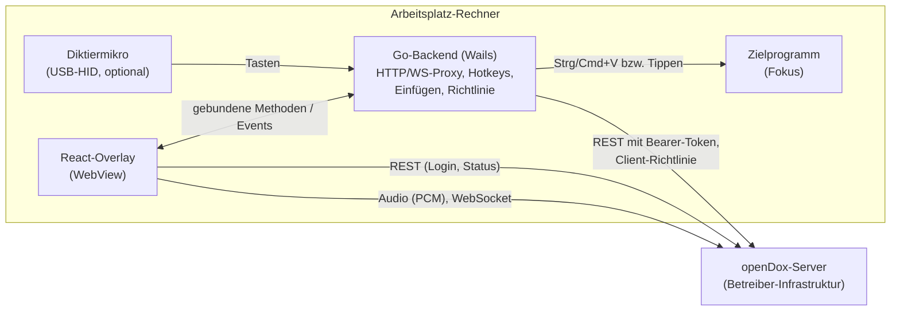

# openDox Client — was das ist und wie es funktioniert

Der openDox Client ist ein kleines Desktop-Programm (Windows, macOS, Linux), das als
**Overlay immer im Vordergrund** liegt. Man diktiert, der Text wird live angezeigt und nach
einem expliziten Bestätigungsschritt in das gerade aktive Programm eingefügt (Praxis-/
Kliniksoftware, Textverarbeitung, E-Mail, …). Die eigentliche Arbeit — Transkription und
Zusammenfassung — macht ein **separat betriebener openDox-Server**; der Client ist nur die
Bedienoberfläche am Arbeitsplatz plus die Anbindung an das Betriebssystem.

> Kein Medizinprodukt. Transkripte und Zusammenfassungen sind maschinell erstellt und müssen
> von qualifiziertem Fachpersonal geprüft werden, bevor sie verwendet werden — siehe
> [`DISCLAIMER.md`](../DISCLAIMER.md). Der Bestätigungsschritt vor dem Einfügen ist als
> Prüfgelegenheit gedacht.

## Wozu ein eigener Client, wenn der Server eine Weboberfläche hat?

Eine Webseite im Browser kann weder **global** auf Tastenkürzel hören, noch Text in ein
anderes Programm einfügen, noch Tasten eines Diktiermikrofons lesen. Genau das braucht der
Arbeitsplatz aber: Der Arzt arbeitet in seiner Fachsoftware, drückt `Strg+Alt+R`, spricht,
und der Text landet dort, wo der Cursor steht.

| Aufgabe | Wer macht es |
|---|---|
| Audio aufnehmen, live anzeigen | Client (Mikrofon über die eingebettete WebView) → Server |
| Transkription (Whisper/Parakeet), PII-Maskierung, LLM-Zusammenfassung, Speicherung | **Server** |
| Anmeldung (Passwort, SSO/OIDC), Rollen, Kategorien | Server (der Client zeigt nur die Anmeldung an) |
| Globale Hotkeys, Diktiermikro-Tasten, Einfügen in das Zielprogramm | **Client** (Betriebssystem-Anbindung) |
| Zwischenablage absichern, Einfügeziel prüfen | Client |
| Client-Richtlinie (Zwischenablage, Allow-Liste, Mic-Modus, Live-Ansicht, Design) | Admin gibt sie im Server vor, der Client holt sie beim Start ab; `settings.json` und (bei Mic-Modus, Live-Ansicht, Design) die Wahl des Nutzers gewinnen |

## Überblick

Der Client spricht **ausschließlich mit der konfigurierten Server-Adresse** — es gibt keine
Telemetrie, keine Update-Abfrage und keine externen Ressourcen (Schriften sind eingebettet).
Details: [`data-mapping.md`](data-mapping.md).

## Funktionen

- **Aufnehmen und live mitlesen** — Start/Stopp/Pause per Button oder Hotkey; Text erscheint
  während des Sprechens (abschaltbar, dann nur ein Orb).
- **Akzeptieren und einfügen** — fügt den fertigen Text in das aktive Programm ein
  (`Strg+Alt+V` oder Button). Unter Windows wird per `Strg+V` eingefügt, in Citrix-Clients
  getippt; macOS: `Cmd+V`; Linux: simuliertes `Strg+V`.
- **Globale Hotkeys** — `Strg+Alt+R` Aufnahme, `P` Pause, `V` einfügen, `D` halten zum
  Sprechen, `H` Overlay aus-/einblenden (macOS: `Cmd+Option`).
- **Diktiermikros** — Tasten von Philips SpeechMike / Nuance PowerMic (Standard: Halten =
  aufnehmen, Loslassen = stoppen und einfügen). Die Tastenbelegung ist noch nicht an echter
  Hardware verifiziert, siehe [`superpowers/specs/2026-08-06-dictation-mic-design.md`](superpowers/specs/2026-08-06-dictation-mic-design.md).
- **Kategorien** — wählt die Dokumentationsvorlage des Servers (z. B. „Allgemein“).
- **Anmeldung** — Passwort oder SSO (OIDC über den System-Browser).
- **Schutz der Zwischenablage (Windows)** — Text wird aus Verlauf (Win+V) und Cloud-
  Zwischenablage herausgehalten und nach 30 s geleert, sofern unverändert; optional eine
  Allow-Liste der Zielprogramme.

## Zwei Dinge, die man leicht verwechselt

**Hotkey und Fokus.** Das Overlay nimmt dem Zielprogramm den Fokus nicht weg (Windows:
`WS_EX_NOACTIVATE`); ein Button-Klick ändert daher nicht, *wohin* eingefügt wird. Unter
macOS/Linux blendet der Client das Overlay beim Button-Einfügen kurz aus.

**„Fertig“ ist nicht „Socket zu“.** Nach dem Stopp läuft serverseitig noch die
Verarbeitung (Transkription, Zusammenfassung). Der Client fragt den Status ab, bis sie
beendet ist; erst dann ist der Text final. Details für Entwickler: [`../.agents/AGENTS.md`](../.agents/AGENTS.md)
(„Recording flow“).

## Konfiguration

Der Client braucht **nur die Server-Adresse** (`settings.json` neben dem Programm oder im
Benutzer-Konfigordner). Vorgaben für alles Weitere kann der Admin zentral im Server unter
*Admin → Clients* einstellen; der Client holt sie einmal beim Start
(`GET /api/v1/settings/client-config/`). Was in der lokalen `settings.json` steht, gewinnt
gegenüber dem Server; der letzte Stand wird zwischengespeichert, falls der Server mal nicht
erreichbar ist. Design, Live-Ansicht und Mikrofontaste stellt der Nutzer selbst im Overlay um
(`preferences.json`, gewinnt gegenüber beidem).

- Schlüssel und Defaults: [`../README.md`](../README.md#konfiguration)
- Verteilung per Intune/SCCM/GPO: [`../build/windows/installer/DEPLOYMENT.md`](../build/windows/installer/DEPLOYMENT.md)

## Aufbau des Repositorys

| Pfad | Inhalt |
|---|---|
| `app.go`, `main.go`, `oidc.go` | Wails-Anbindung: das einzige ans Frontend gebundene Objekt `App`, Start, nativer OIDC-Login |
| `insert_*.go`, `paste_*.go`, `clipboard_*.go`, `focus_*.go` | Einfügen je Betriebssystem (Build-Tags + Stubs) |
| `dictation_mic*.go`, `hold_tracker.go` | USB-HID-Tasten der Diktiermikros |
| `policy_sync.go`, `internal/clientpolicy/` | Client-Richtlinie vom Server und Nutzer-Einstellungen (`preferences.json`): Abruf, Cache, Zusammenführen (ohne OS-Abhängigkeit testbar) |
| `internal/winclip/`, `internal/winfocus/` | Windows: Zwischenablage-Markierung, Vordergrundprogramm |
| `frontend/` | React/TypeScript-Overlay (`Recorder.tsx` ist das Herzstück) |
| `build/` | Installer (MSI/NSIS), Plist, Manifest; `DEPLOYMENT.md` für IT |
| `third_party/` | gepatchte Abhängigkeiten (`hid`, `hotkey`), per `replace` in `go.mod` |
| `scripts/` | Version, Lizenzprüfung, SPDX-Header, Release-Upload |

## Mitmachen, Releases, Sicherheit

- Entwicklung, Builds, Tests: [`../README.md`](../README.md) und [`../CONTRIBUTING.md`](../.github/CONTRIBUTING.md)
- Release-Ablauf: [`../CONTRIBUTING.md`](../.github/CONTRIBUTING.md#releases) · Änderungen: [`../CHANGELOG.md`](../CHANGELOG.md)
- Sicherheitsmeldungen und Schutzmaßnahmen: [`../SECURITY.md`](../.github/SECURITY.md)
- Zweckbestimmung und Abgrenzung zum Medizinprodukt: [`zweckbestimmung.md`](zweckbestimmung.md)
- Einordnung in Rahmenwerke (ISO 27001, NIS2, CRA, MDR, DSGVO): [`rahmenwerke.md`](rahmenwerke.md)
- Datenfluss (Grundlage für ein Verzeichnis von Verarbeitungstätigkeiten):
  [`data-mapping.md`](data-mapping.md)
- Selbstauskunft für Audits: [`audit-checklist-opendox-client.md`](audit-checklist-opendox-client.md)
- Lizenz: AGPL-3.0-or-later ([`../LICENSE`](../LICENSE)), Abhängigkeiten in
  [`../THIRD_PARTY_NOTICES.md`](../THIRD_PARTY_NOTICES.md)
